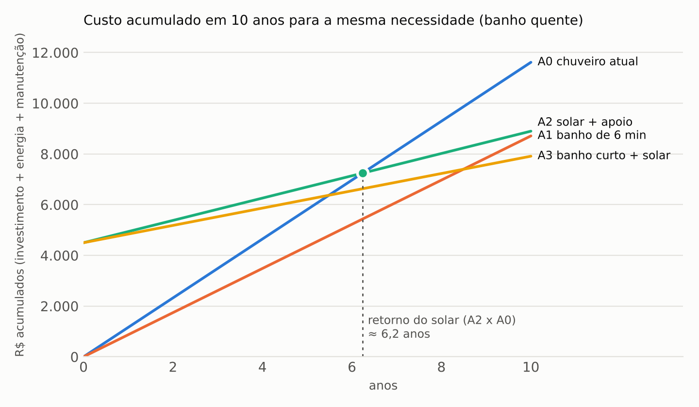

# Citizen Assist AI — Módulo Energia

**Global Solution 2026.2 · FIAP · Ciência da Computação · Turma 1CC**
**Disciplina: Soluções em Energias Renováveis e Sustentáveis (SERS)**

Orientações sobre **uso consciente de energia** para o assistente digital Citizen Assist AI: quanto o chuveiro elétrico gasta, o que dá para
economizar sem investir e quando um **aquecedor solar (fonte renovável)** compensa, com cálculos reproduzíveis, fontes com data de consulta e limitações explícitas.

## Integrantes

| Nome completo | RM |
| --- | --- |
| João Pedro Costenari Silva | 572260 |
| João Victor Canello Ferian | 573295 |
| Gustavo Melo dos Santos | 573562 |

**Contribuição de Energias Renováveis e Sustentáveis (este repositório):** João Pedro Costenari Silva (RM 572260).
As demais disciplinas do Citizen Assist AI (Computer Science, Prompt & AI, DSA, Pensamento Computacional, Modelagem Linear, Modelagem Matemática, COA) têm entregas próprias; a integração com o assistente principal está descrita em [`docs/07_integracao_citizen_assist.md`](docs/07_integracao_citizen_assist.md).

## Público e problema

**Público:** moradores de residências urbanas com chuveiro elétrico que procuram o assistente para entender e reduzir a conta de luz, em especial famílias de renda baixa e média.
**Necessidade:** água quente do banho, o uso que mais pesa na conta de quem tem chuveiro elétrico.
Detalhes e perfis de teste: [`docs/01_contexto_publico_necessidade.md`](docs/01_contexto_publico_necessidade.md).

## Funcionalidades de energia

1. **Consumo e custo do chuveiro:** `E (kWh/mês) = potência (kW) x minutos por banho/60 x banhos por dia x 30`, e custo = kWh x tarifa.
2. **Comparação de alternativas para a mesma necessidade e o mesmo período (12 meses; retorno em 10 anos):**
   **A0** situação atual · **A1** banho mais curto (economia por hábito) · **A2** aquecedor solar com apoio elétrico (**renovável**) · **A3** A1 + A2.
3. **Recomendações em linguagem simples**, com custos, viabilidade (autorização, sol, altura da caixa d'água) e impacto ambiental (CO2 e água).
4. **Fontes, premissas e limitações** em toda resposta; dados estimados ficam marcados como estimados.
5. **Tratamento de entradas inválidas**, sem travar, e **nenhum dado pessoal** é pedido.
6. **Saída JSON** para o assistente principal (`energia/api.py`) e definição de ferramenta para LLM (`integracao/`).

## Como executar e testar

Requisito: Python 3.8 ou mais novo (nenhuma biblioteca extra para executar e testar).

```bash
python assistente_energia.py                 # conversa interativa em português
python assistente_energia.py --demo          # demonstração automática (inclui entradas inválidas)
python assistente_energia.py --pessoas 4 --minutos 8 --tarifa 1,10 --conta-kwh 300   # uma consulta direta
python assistente_energia.py --json --pessoas 4 --minutos 8                          # saída JSON (integração)

python -m unittest discover -s tests -v      # 40 testes automáticos (valores calculados à mão)

pip install -r requirements.txt              # só para regenerar gráficos e tabelas dos documentos
python scripts/gerar_resultados.py
```

## Resultado do cenário-base

Família de 4 pessoas, 1 banho por pessoa por dia de 8 min, chuveiro de 5.500 W, kWh a R$ 1,10 (média estimada para 2026 com tributos), bandeira verde.

| Alternativa | kWh/ano | Custo de energia/ano | Investimento | Economia líquida/ano | Retorno |
| --- | --- | --- | --- | --- | --- |
| A0 Chuveiro elétrico (atual) | 1.056 | R$ 1.161,60 | - | - | - |
| A1 Banho de 6 min (hábito) | 792 | R$ 871,20 | R$ 0 | R$ 290,40 | imediato |
| A2 Aquecedor solar + apoio elétrico (**renovável**) | 359 | R$ 394,94 | R$ 4.500 | R$ 721,66 | 6,2 anos |
| A3 A1 + A2 (renovável) | 269 | R$ 296,21 | R$ 4.500 | R$ 820,39 | 5,5 anos (8,5 anos sobre A1) |



**Principais recomendações e limites**

* Comece pelo banho de 6 minutos (custo zero); o solar rende menos para quem já encurtou o banho.
* O solar **vale pedir orçamentos** neste perfil (retorno ≈ 6,2 anos), mas **só** com imóvel próprio ou autorização, telhado com sol sem sombra e caixa d'água a até 5 m do reservatório [R1].
* O retorno é **muito sensível** à tarifa e ao tamanho da família: para 2 pessoas passa de 13 anos; com kWh a R$ 0,74 e sistema de R$ 6.000, chega a 13,2 anos ([sensibilidade](docs/03_calculos_e_comparacao.md)).
* O CO2 evitado é pequeno (≈ 17 kg por ano com o solar) porque a rede elétrica brasileira já emite pouco [R8]; o ganho é principalmente financeiro.
* **Estimativas, não garantias.** Preços, tarifa e redução de consumo variam. O retorno é "simples" (sem juros nem reajuste de tarifa).

## Estrutura do repositório

```text
.
├── README.md                    <- este arquivo
├── assistente_energia.py        <- executa o assistente (conversa, --demo, --json)
├── energia/                     <- módulo de energia (contribuição de SERS ao Citizen Assist AI)
│   ├── parametros.py            <- carrega dados/parametros.json
│   ├── calculos.py              <- fórmulas e comparação de alternativas
│   ├── recomendacao.py          <- regras de recomendação, referências e limitações
│   ├── assistente.py            <- diálogo em português com validação de entradas
│   └── api.py                   <- consultar_energia(): integração com o assistente principal
├── dados/                       <- parâmetros com origem/premissas e resultados em CSV
├── docs/                        <- 01 contexto · 02 dados e premissas · 03 cálculos e comparação
│                                   04 justificativas · 05 referências · 06 testes com usuários · 07 integração
├── integracao/                  <- ferramenta (JSON), fragmento de prompt e exemplo de roteamento
├── scripts/gerar_resultados.py  <- recria CSVs, gráficos e tabelas dos documentos
└── tests/test_energia.py        <- testes automáticos
```

## Documentação

| Exigência do enunciado | Onde está |
| --- | --- |
| Definição do contexto (público, necessidade, contribuição) | [`docs/01_contexto_publico_necessidade.md`](docs/01_contexto_publico_necessidade.md) |
| Dados com origem, unidades, período e premissas (estimados identificados) | [`docs/02_dados_e_premissas.md`](docs/02_dados_e_premissas.md) · [`dados/parametros.json`](dados/parametros.json) |
| Cálculos e comparação das alternativas | [`docs/03_calculos_e_comparacao.md`](docs/03_calculos_e_comparacao.md) · [`dados/`](dados) |
| Justificativas (custos, viabilidade, impactos ambientais) | [`docs/04_justificativas_recomendacoes.md`](docs/04_justificativas_recomendacoes.md) |
| Referências | [`docs/05_referencias.md`](docs/05_referencias.md) |
| Testes com usuários e ajustes | [`docs/06_testes_com_usuarios.md`](docs/06_testes_com_usuarios.md) |
| Integração ao assistente | [`docs/07_integracao_citizen_assist.md`](docs/07_integracao_citizen_assist.md) · [`integracao/`](integracao) |

## Uso de IA generativa

Ferramentas de IA generativa foram usadas como apoio (pesquisa de fontes, estrutura do código e redação). As fontes foram abertas e lidas em 18/11/2026
(`docs/05_referencias.md`), os cálculos podem ser refeitos à mão com as fórmulas do `docs/03_calculos_e_comparacao.md` e os testes automáticos conferem
os resultados com valores calculados manualmente. As premissas estimadas estão marcadas como tal; a equipe responde pelos dados, cálculos e recomendações.

## Aviso

Protótipo educativo. **Não é canal oficial** de distribuidora ou órgão público, não confirma descontos (como a tarifa social) nem concessão de serviços,
**não coleta dados pessoais** e as estimativas **não são garantia** de economia, geração ou custo.
