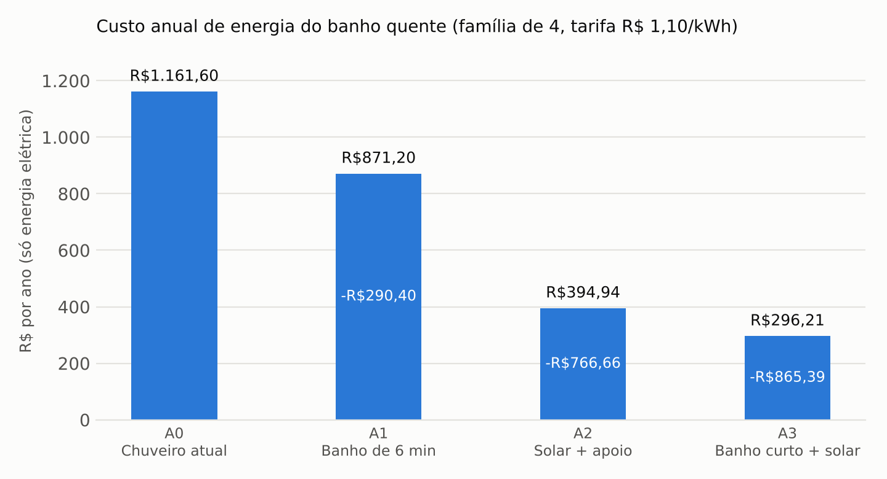
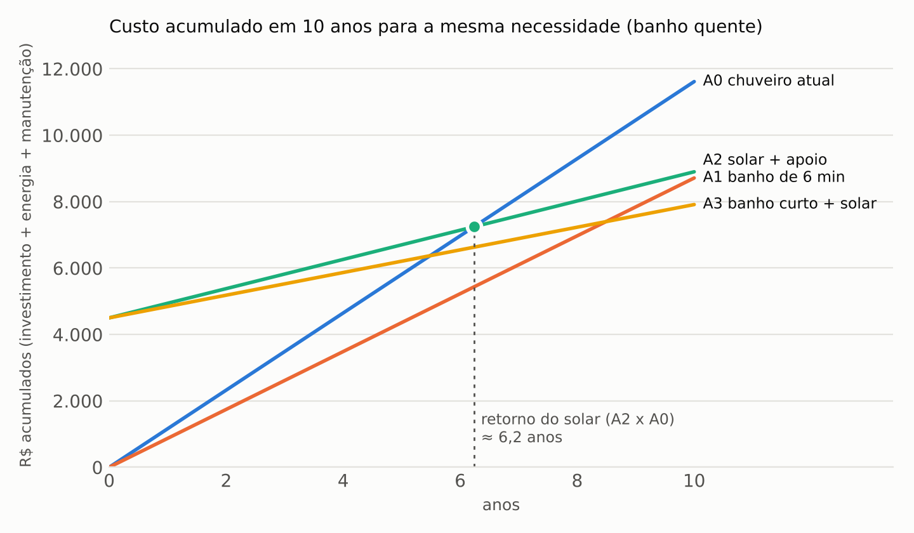
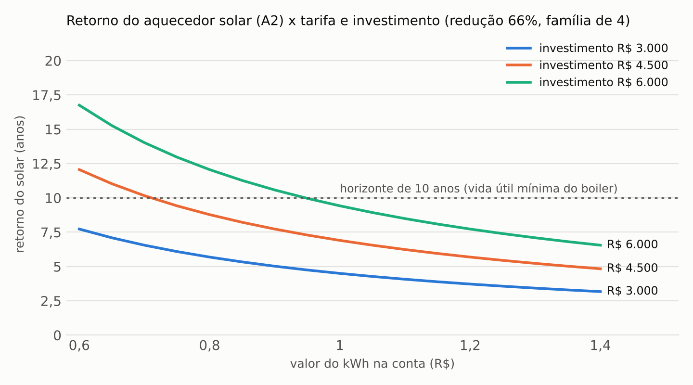

# 3. Cálculos e comparação das alternativas

## 3.1 Necessidade, período e cenário de referência

* **Necessidade (a mesma para todas as alternativas):** água quente para o banho de uma família de 4 pessoas.
* **Período de referência comum:** 12 meses; o retorno do investimento é avaliado em um horizonte de 10 anos.
* **Cenário-base:** 4 pessoas, 1,0 banho/pessoa/dia, 8 min por banho, chuveiro elétrico de 5.500 W, kWh a R$ 1,10 (tarifa média estimada 2026 com tributos, arredondada), bandeira verde.
* **Alternativas:** A0 situação atual (comparação) · **A1** banho mais curto (economia por hábito) · **A2** aquecedor solar com apoio elétrico (**fonte renovável**) · **A3** A1 + A2.

## 3.2 Fórmulas

```text
E_mes  [kWh]  = P [kW] x t_banho [h] x banhos_por_dia x 30
custo  [R$]   = E x tarifa [R$/kWh]
A1: mesma fórmula com t_banho = min(t_atual, 6 min)
A2: E_A2 = E_A0 x (1 - r)        r = redução com solar e apoio elétrico (0,66)
manutenção    = 1% x investimento por ano
economia líquida = (custo_A0 - custo_alternativa) - manutenção
retorno [anos]   = investimento / economia líquida por ano
CO2 evitado [kg] = (E_A0 - E_alternativa) x fator de emissão (0,024725 kg/kWh)
água economizada [L/mês] = (t_A0 - t_A1) x vazão (5 L/min) x banhos_por_dia x 30
```

## 3.3 Cálculo passo a passo (cenário-base)

**A0 (situação atual)**  
`E = 5,5 kW x (8/60 h) x 4 banhos/dia x 30 dias = 88 kWh/mês`  ->  `x 12 = 1.056 kWh/ano`  ->  `x R$ 1,10 = R$ 1.161,60 por ano`

**A1 (banho de 6 minutos)**  
`E = 5,5 kW x (6/60 h) x 4 x 30 = 66 kWh/mês`  ->  `792 kWh/ano`  ->  `R$ 871,20 por ano`; economia = R$ 1.161,60 - R$ 871,20 = **R$ 290,40 por ano** (25%).

**A2 (aquecedor solar com apoio elétrico)**  
`kWh/ano = 1.056 x (1 - 0,66) = 359,04`  ->  `custo = R$ 394,94 por ano`; economia bruta = R$ 766,66; manutenção = 1% x R$ 4.500,00 = R$ 45,00; **economia líquida = R$ 721,66 por ano**; **retorno = R$ 4.500,00 / R$ 721,66 = 6,2 anos**.

**A3 (A1 + A2)**  
`kWh/ano = 792 x (1 - 0,66) = 269,28`  ->  `custo = R$ 296,21 por ano`; economia líquida sobre A0 = R$ 820,39 por ano (retorno 5,5 anos). **Sobre A1** (quem já adotou o banho curto) a economia líquida do solar é R$ 529,99 por ano e o retorno sobe para **8,5 anos**.

## 3.4 Resultado da comparação (12 meses)

| Alternativa | kWh/ano | Custo de energia/ano | Investimento | Economia líquida/ano | Retorno | Ganho líquido em 10 anos | CO2 evitado (kg/ano) | Água economizada (L/mês) |
| --- | --- | --- | --- | --- | --- | --- | --- | --- |
| A0 Situação atual: chuveiro elétrico | 1.056 | R$ 1.161,60 | - | - | - | - | 0,0 | 0 |
| A1 Economia por hábito: banho mais curto | 792 | R$ 871,20 | - | R$ 290,40 | imediato | R$ 2.904,00 | 6,5 | 1.200 |
| A2 Aquecedor solar com apoio elétrico (renovável) | 359 | R$ 394,94 | R$ 4.500,00 | R$ 721,66 | 6,2 anos | R$ 2.716,56 | 17,2 | 0 |
| A3 Banho mais curto + aquecedor solar (renovável) | 269 | R$ 296,21 | R$ 4.500,00 | R$ 820,39 | 5,5 anos | R$ 3.703,92 | 19,5 | 1.200 |





**Leitura:** o banho de 6 minutos (A1) é o que mais rende por real investido (custo zero), mas muda o hábito. O aquecedor solar (A2) mantém o banho
como é e economiza mais por ano, porém exige investimento e só se paga em ≈ 6,2 anos. Juntos (A3), o solar rende menos sobre quem já encurtou o banho (retorno de ≈ 8,5 anos sobre A1).
O estudo do IDEC [R1] indica retorno entre 2 e 7 anos; o resultado-base (6,2 anos) cai dentro dessa faixa, perto do limite superior.

## 3.5 Sensibilidade: o que muda o resultado

O retorno do solar (A2) é **muito sensível à tarifa**. Retorno (anos), redução de 66%, família de 4:

| Valor do kWh | R$ 3.000 | R$ 4.500 | R$ 6.000 |
| --- | --- | --- | --- |
| R$ 0,74 | 6,2 anos | 9,6 anos | 13,2 anos |
| R$ 0,85 | 5,3 anos | 8,2 anos | 11,3 anos |
| R$ 1,10 | 4,1 anos | 6,2 anos | 8,5 anos |
| R$ 1,30 | 3,4 anos | 5,2 anos | 7,1 anos |



Efeito da **redução** efetivamente obtida (tarifa R$ 1,10; investimento R$ 4.500):

| Redução do consumo do chuveiro | 50% | 66% | 70% |
| --- | --- | --- | --- |
| Retorno (investimento R$ 4.500, kWh a R$ 1,10) | 8,4 anos | 6,2 anos | 5,9 anos |

Efeito do **tamanho da família** (tarifa R$ 1,10; investimento R$ 4.500; redução de 66%; 8 min; mesmo sistema):

| Pessoas na casa | Chuveiro (kWh/mês) | Custo/ano (A0) | Retorno do solar (A2) |
| --- | --- | --- | --- |
| 2 | 44 | R$ 580,80 | 13,3 anos |
| 3 | 66 | R$ 871,20 | 8,5 anos |
| 4 | 88 | R$ 1.161,60 | 6,2 anos |
| 5 | 110 | R$ 1.452,00 | 4,9 anos |

> Conclusão honesta: com tarifa baixa (R$ 0,74/kWh) e investimento alto, o solar **não** se paga dentro de 10 anos para uma família de 4;
> para famílias pequenas o retorno é bem mais longo. Por isso o assistente pede a tarifa da conta, o número de pessoas e o tempo de banho.

## 3.6 Teste de coerência com a conta de luz

Se a pessoa informa o consumo total da conta (kWh/mês), o assistente compara com o chuveiro estimado: se passa de 60% da conta, mostra alerta
(provável posição "verão" ou banho curto); se o chuveiro estimado passa de 100% da conta, o dado é recusado como incoerente.
No cenário-base, 88 kWh/mês correspondem a ≈ 29% de uma conta de 300 kWh.

## 3.7 Teste de ordem de grandeza do coletor (PBE/Inmetro)

Um coletor classe A da linha consultada [R3] declara **121,4 kWh/mês**. A demanda do chuveiro no cenário-base é **88 kWh/mês**, portanto
um coletor produz ≈ **1,4** vezes a demanda. Isso mostra que a **energia disponível não é o fator limitante**; o limite da economia são dias
nublados, uso do apoio elétrico e perdas, motivo pelo qual adotamos redução de 66% (e não 100%). O dimensionamento final cabe a um instalador.

## 3.8 Limitações dos cálculos

* Os cálculos usam valores médios (tarifa nacional, potência de 5.500 W, tempo de banho típico). Informe os dados da SUA conta e do SEU chuveiro para chegar mais perto da realidade.
* Retorno do investimento é 'simples': sem juros, sem reajuste de tarifa e sem desconto de tarifa social.
* A redução do aquecedor solar (50% a 70%) vem de um estudo de caso e de material de fabricante; depende de orientação do telhado, sombra, clima e do uso do apoio elétrico.
* Preços de sistemas solares variam por região e por fornecedor: peça pelo menos 3 orçamentos.
* O fator de emissão usado é o MÉDIO da rede (jan-abr/2025); o efeito real de economizar energia pode ser diferente.
* A alternativa A1 (banho mais curto) muda o hábito; as alternativas A2/A3 mantêm o mesmo tempo de banho.
* Não há desconto a valor presente nem reajuste de tarifa; ambos mudariam o retorno (reajustes tendem a encurtá-lo; juros altos, a alongá-lo).
* O modelo considera um chuveiro elétrico sempre na potência nominal; na posição "verão" o consumo real é menor.

## 3.9 Como reproduzir

```bash
python scripts/gerar_resultados.py     # recria CSVs, gráficos e as tabelas deste documento
python -m unittest discover -s tests   # confere as fórmulas com valores calculados à mão
```

Arquivos gerados em [`dados/`](../dados): `resultado_cenario_base.csv`, `sensibilidade_payback_a2.csv`, `custo_acumulado_10_anos.csv`.
